<div align="center">


</div>

<div align="center">

<a href="https://www.linkedin.com/in/iv%C3%A1n-requena-puig/"></a>
<a href="mailto:ivanrequenapuig@gmail.com"></a>
<a href="https://portfolioivanrequena.netlify.app/"></a>

</div>

## 👾 Sobre mí 👾

```js
const developer = {
  name: "Iván Requena Puig",
  title: "Full Stack Developer",
  location: "Valencia, España",
  availableForHire: true,
  education: ["DAM (Técnico Superior en Desarrollo de Aplicaciones Multiplataforma)", "DAW (cursando, IES Abastos)"],
  interests: ["Desarrollo Web", "Frontend 3D", "Backend con Laravel / Node", "WordPress & SEO"],
  motivation: "Convertir ideas en productos digitales que funcionan bien y se ven mejor"
};
```

<div align="center"></div>

## ☂️ Tech Stack ☂️

<div align="center">
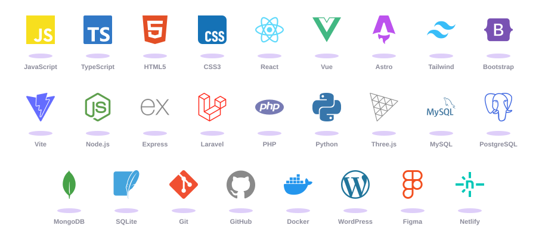
</div>

<div align="center"></div>

## 🎮 Webs de Videojuegos 🎮

<table>
<tr>
<td width="50%" valign="top" align="center">
<h3>Neon Siege 🔫</h3>
<p><b>Shooter de supervivencia por oleadas con jefes y skins</b></p>
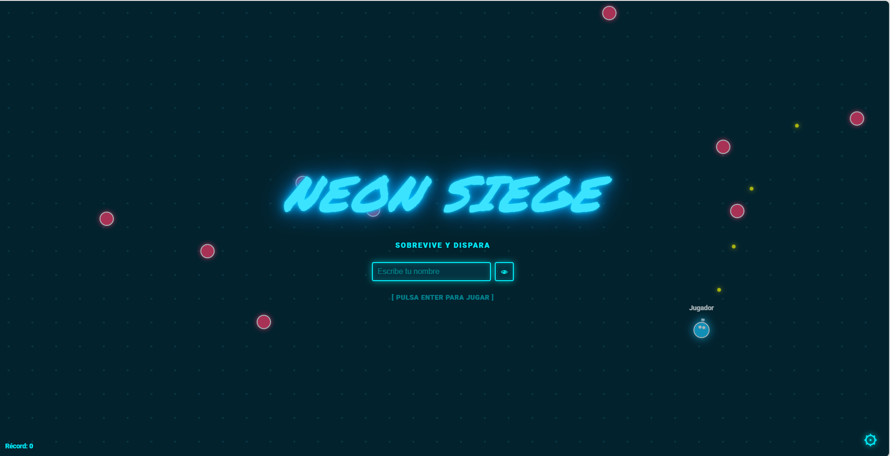
<p><a href="https://github.com/IvanRequenaPuig/NEON-SIEGE-OFFLINE"></a><a href="https://ivanrequenapuig.github.io/NEON-SIEGE-OFFLINE/"></a></p>
<ul align="left"><li>🖥️ <b>Frontend:</b> HTML5 Canvas, CSS3, JavaScript</li><li>✨ <b>Extras:</b> 3 armas, esquivar con dash y jefe cada 5 oleadas</li><li>✨ <b>Extras:</b> 10 skins con rareza y ranking local</li><li>🚀 <b>Deploy:</b> GitHub Pages</li></ul>
</td>
<td width="50%" valign="top" align="center">
<h3>Star Dodger 🌠</h3>
<p><b>Esquiva meteoritos, salta el fuego y atrapa estrellas</b></p>
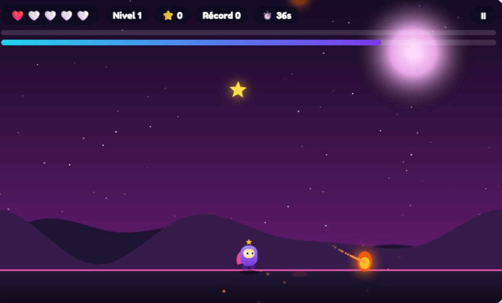
<p><a href="https://github.com/IvanRequenaPuig/Star-Dodger"></a><a href="https://ivanrequenapuig.github.io/Star-Dodger/"></a></p>
<ul align="left"><li>🖥️ <b>Frontend:</b> HTML5 Canvas, CSS3, JavaScript</li><li>✨ <b>Extras:</b> Niveles, combos, vidas y lluvia de meteoritos</li><li>✨ <b>Extras:</b> 7 logros, 4 personajes y música con Web Audio API</li><li>🚀 <b>Deploy:</b> GitHub Pages</li></ul>
</td>
</tr>
<tr>
<td width="50%" valign="top" align="center">
<h3>Ajedrez ♟️</h3>
<p><b>Ajedrez contra la CPU con 8 niveles y modo 2 jugadores</b></p>
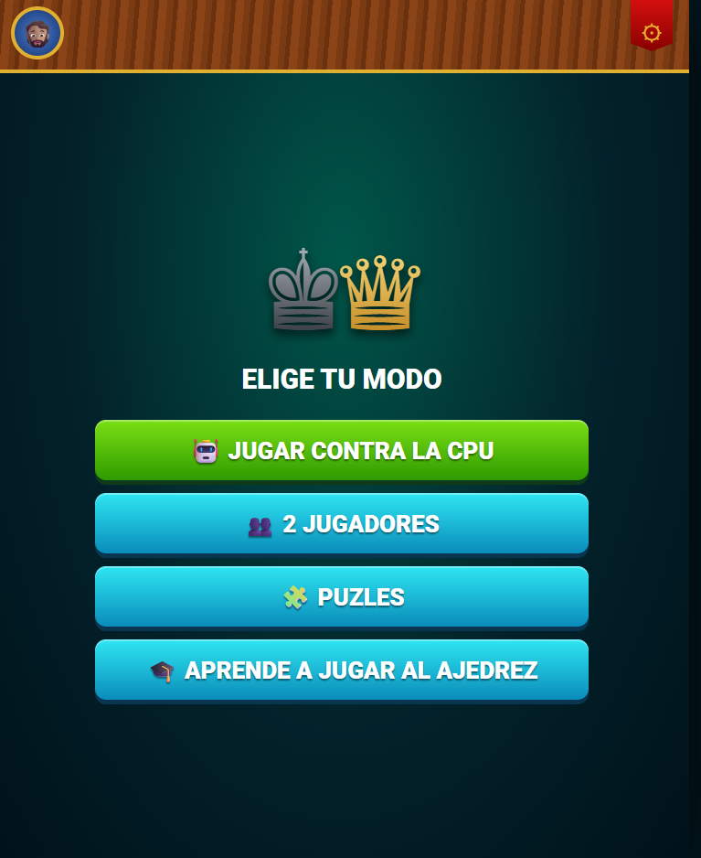
<p><a href="https://github.com/IvanRequenaPuig/Ajedrez"></a><a href="https://ivanrequenapuig.github.io/Ajedrez/"></a></p>
<ul align="left"><li>🖥️ <b>Frontend:</b> HTML5, CSS3, JavaScript</li><li>🧩 <b>Motor:</b> Reglas completas e IA minimax con poda alfa-beta</li><li>✨ <b>Extras:</b> Pistas, deshacer, estadísticas y diseño responsive</li><li>🚀 <b>Deploy:</b> GitHub Pages</li></ul>
</td>
<td width="50%" valign="top" align="center">
<h3>Hundir la Flota 🚢</h3>
<p><b>Naval Command: batalla naval contra una IA</b></p>
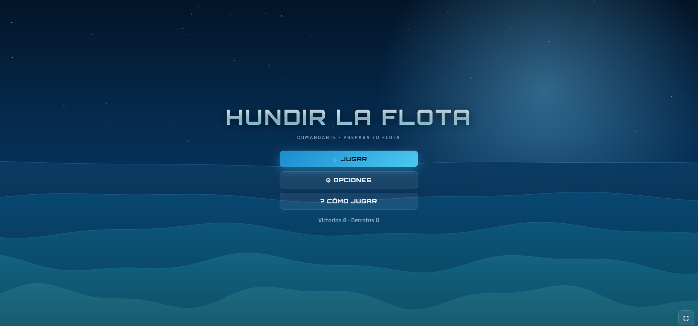
<p><a href="https://github.com/IvanRequenaPuig/Hundir-La-Flota"></a><a href="https://ivanrequenapuig.github.io/Hundir-La-Flota/"></a></p>
<ul align="left"><li>🖥️ <b>Frontend:</b> HTML5, CSS3, JavaScript</li><li>⚙️ <b>IA:</b> 3 dificultades, desde básica hasta con probabilidades</li><li>✨ <b>Extras:</b> Fondo de mar animado, sonido de oleaje y ajustes</li><li>🚀 <b>Deploy:</b> GitHub Pages</li></ul>
</td>
</tr>
</table>

<div align="center"></div>

## 💜 Proyectos Destacados 💜

<table>
<tr>
<td width="50%" valign="top" align="center">
<h3>Piratas del Caribe 🏴‍☠️</h3>
<p><b>Web de fans con mar 3D que cambia del día a la tormenta</b></p>
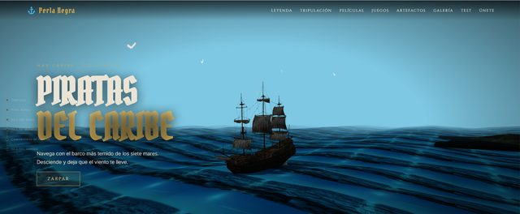
<p><a href="https://github.com/IvanRequenaPuig/PiratasDelCaribe"></a><a href="https://piratasdelcaribeweb.netlify.app/"></a></p>
<ul align="left"><li>🖥️ <b>Frontend:</b> HTML5, CSS3, JavaScript</li><li>🎮 <b>3D:</b> Three.js + Web Audio API</li><li>🚀 <b>Deploy:</b> Netlify</li></ul>
</td>
<td width="50%" valign="top" align="center">
<h3>Inmobiliaria Requena 🏡</h3>
<p><b>Web corporativa con filtros, fichas y PDF</b></p>
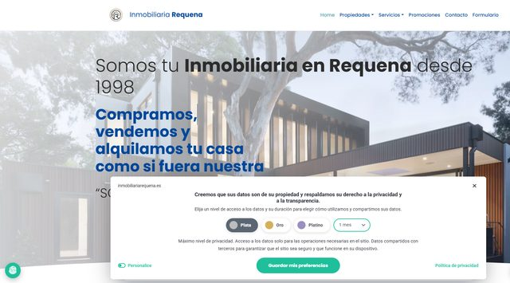
<p><a href="https://github.com/IvanRequenaPuig/InmobiliariaIvan"></a><a href="https://inmobiliariarequena.netlify.app/"></a></p>
<ul align="left"><li>🖥️ <b>Frontend:</b> HTML5, JavaScript</li><li>🎨 <b>Estilos:</b> Bootstrap 5</li><li>✨ <b>Extras:</b> Web Share API, mapas, exportar a PDF</li><li>🚀 <b>Deploy:</b> Netlify</li></ul>
</td>
</tr>
<tr>
<td width="50%" valign="top" align="center">
<h3>Tesla Landing ⚡</h3>
<p><b>Landing inspirada en Tesla con scroll-snap</b></p>
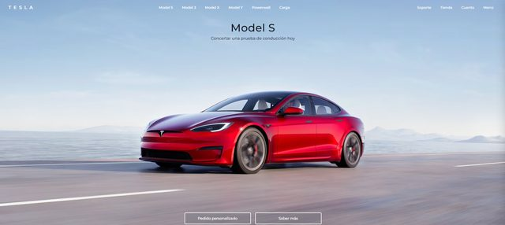
<p><a href="https://github.com/IvanRequenaPuig/TeslaAstro"></a><a href="https://teslalandingweb.netlify.app/"></a></p>
<ul align="left"><li>🧩 <b>Framework:</b> Astro + TypeScript</li><li>🎨 <b>Estilos:</b> CSS3 + animaciones</li><li>✨ <b>Extras:</b> Vídeo hero, menú accesible</li><li>🚀 <b>Deploy:</b> Netlify</li></ul>
</td>
<td width="50%" valign="top" align="center">
<h3>Marvel Web Fan 🦸</h3>
<p><b>Archivo interactivo del UCM en ES / EN</b></p>
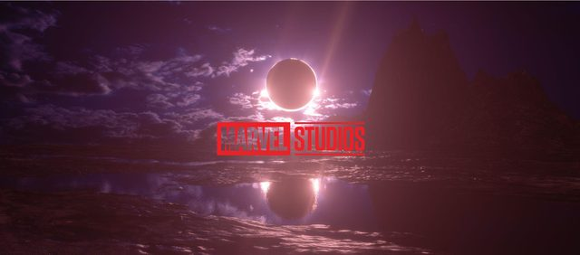
<p><a href="https://github.com/IvanRequenaPuig/MarvelFan"></a><a href="https://marvelwebfan.netlify.app/"></a></p>
<ul align="left"><li>🖥️ <b>Frontend:</b> HTML5, JavaScript</li><li>🎨 <b>Estilos:</b> Bootstrap 5</li><li>✨ <b>Extras:</b> Timeline, quiz, minijuegos, 18 fichas</li><li>🚀 <b>Deploy:</b> Netlify</li></ul>
</td>
</tr>
<tr>
<td width="50%" valign="top" align="center">
<h3>Terror Web Fan 🩸</h3>
<p><b>Enciclopedia interactiva de cine de terror</b></p>
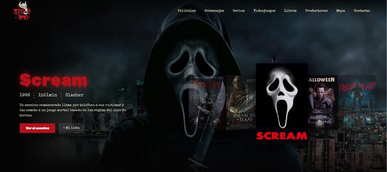
<p><a href="https://github.com/IvanRequenaPuig/TerrorWeb"></a><a href="https://terrorwebfan.netlify.app/"></a></p>
<ul align="left"><li>🖥️ <b>Frontend:</b> HTML5, JavaScript</li><li>🎨 <b>Estilos:</b> Bootstrap + Tailwind CSS</li><li>✨ <b>Extras:</b> Catálogos con filtros, carrusel 3D</li><li>🚀 <b>Deploy:</b> Netlify</li></ul>
</td>
<td width="50%" valign="top" align="center">
<h3>EliteDrive 🚗</h3>
<p><b>Alquiler de coches de alta gama con panel admin</b></p>
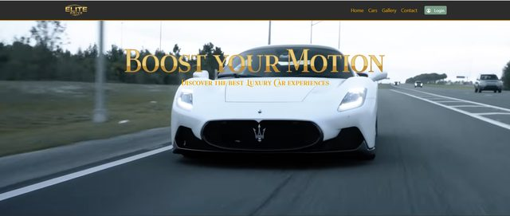
<p><a href="https://github.com/IvanRequenaPuig/Elite-Drive"></a><a href="https://portfolioivanrequena.netlify.app/proyectos.html"></a></p>
<ul align="left"><li>🖥️ <b>Frontend:</b> Vue 3 + Pinia + Vite</li><li>⚙️ <b>Backend:</b> Laravel 12 (PHP 8.2) API</li><li>🗄️ <b>Base de datos:</b> PostgreSQL (Supabase)</li><li>✨ <b>Extras:</b> Reservas por horas, facturas PDF, Docker</li></ul>
</td>
</tr>
<tr>
<td width="50%" valign="top" align="center">
<h3>Peluquería Iván 💈</h3>
<p><b>Barbería con reservas, pagos y panel admin</b></p>
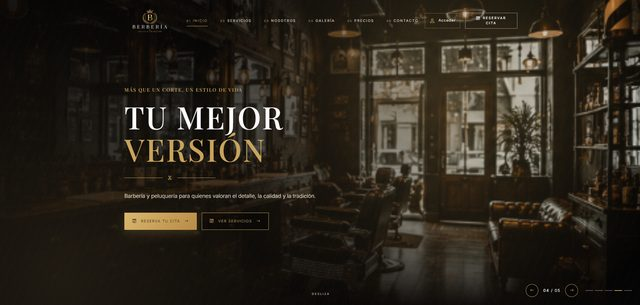
<p><a href="https://portfolioivanrequena.netlify.app/proyectos.html"></a></p>
<ul align="left"><li>⚙️ <b>Backend:</b> Python + API REST + OAuth 2.0</li><li>🗄️ <b>Base de datos:</b> SQLite</li><li>🖥️ <b>Frontend:</b> HTML5, JS, Bootstrap 5</li><li>✨ <b>Extras:</b> Reservas en tiempo real, modo edición</li></ul>
</td>
<td width="50%" valign="top" align="center">
<h3>Yo-kai Watch Fan 👻</h3>
<p><b>Web de fans de Yo-kai Watch</b></p>
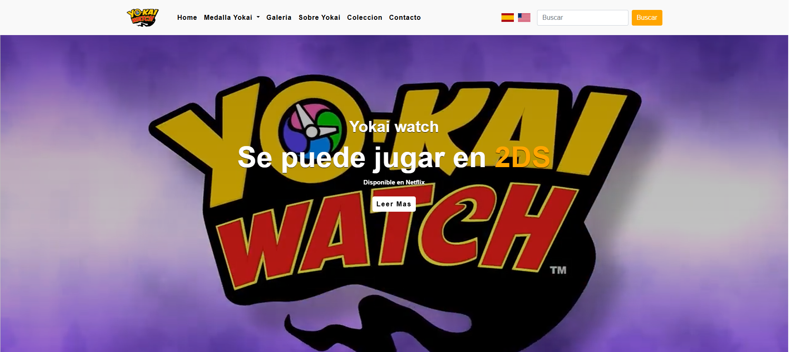
<p><a href="https://github.com/IvanRequenaPuig/Yo-kai-Watch-Bootstrap"></a><a href="https://yokaiwebfan.netlify.app/"></a></p>
<ul align="left"><li>🖥️ <b>Frontend:</b> HTML5, CSS3, JavaScript</li><li>🎨 <b>Estilos:</b> Bootstrap</li><li>🚀 <b>Deploy:</b> Netlify</li></ul>
</td>
</tr>
</table>

> 🎬 Los proyectos **EliteDrive** y **Peluquería Iván** son aplicaciones completas con base de datos y no tienen enlace público: puedes ver el vídeo en mi [portfolio](https://portfolioivanrequena.netlify.app/proyectos.html).

<div align="center"></div>

## 💼 ¿Por qué trabajar conmigo?

<table>
<tr>
<td width="25%" align="center" valign="top">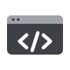<h4>Código Limpio</h4><sub>Escribo código mantenible y escalable siguiendo las mejores prácticas</sub></td>
<td width="25%" align="center" valign="top"><h4>Aprendizaje Continuo</h4><sub>Siempre explorando nuevas tecnologías y metodologías</sub></td>
<td width="25%" align="center" valign="top"><h4>Trabajo en Equipo</h4><sub>Colaborativo, comunicativo y orientado a resultados</sub></td>
<td width="25%" align="center" valign="top"><h4>Proyectos Completos</h4><sub>De la idea al deployment, entrego soluciones funcionales</sub></td>
</tr>
</table>

<div align="center"></div>

## 🧭 Mi trayectoria

<div align="center">
</div>

<div align="center"></div>

## ⚡ Ahora mismo

<div align="center">
</div>

<div align="center"></div>

## 📊 GitHub Stats

<div align="center">
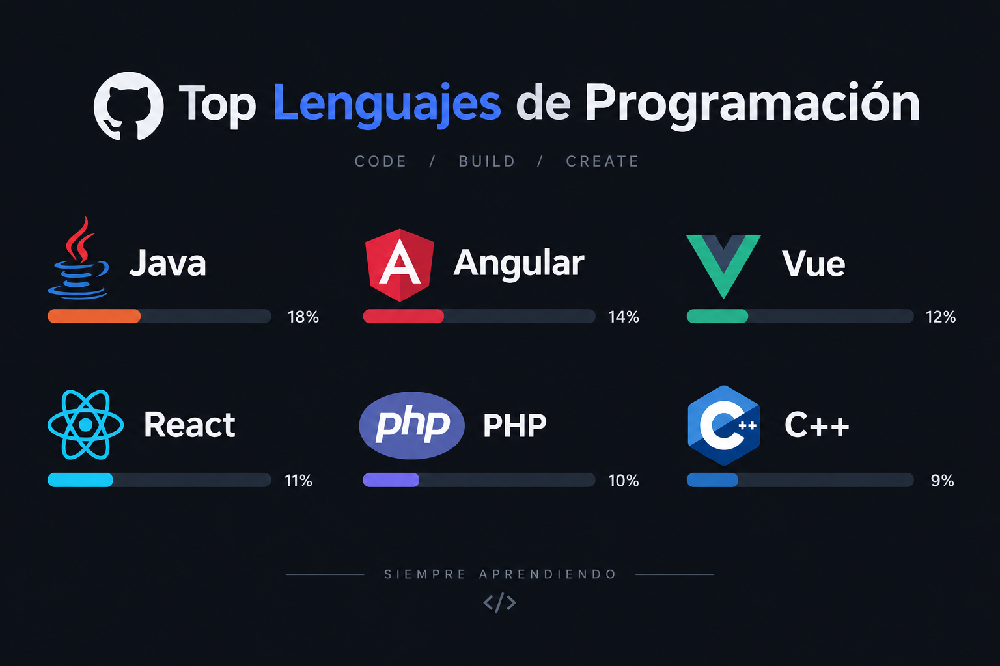
</div>

<div align="center">
<picture>
  <source media="(prefers-color-scheme: dark)" srcset="https://raw.githubusercontent.com/IvanRequenaPuig/IvanRequenaPuig/output/github-snake-dark.svg">
  
</picture>
</div>

## 🏢 Empresas con las que he trabajado

<div align="center">
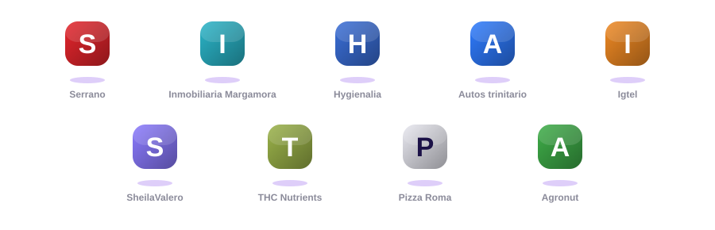
</div>

<div align="center"></div>

<div align="center">
<picture>
  <source media="(prefers-color-scheme: dark)" srcset="https://raw.githubusercontent.com/IvanRequenaPuig/IvanRequenaPuig/output/pacman-contribution-graph-dark.svg">
  
</picture>
</div>

<div align="center">
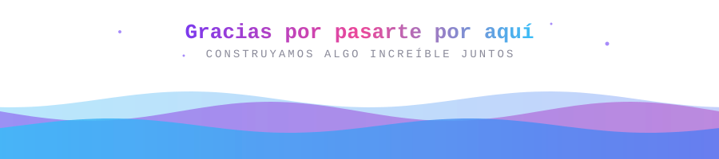
</div>
